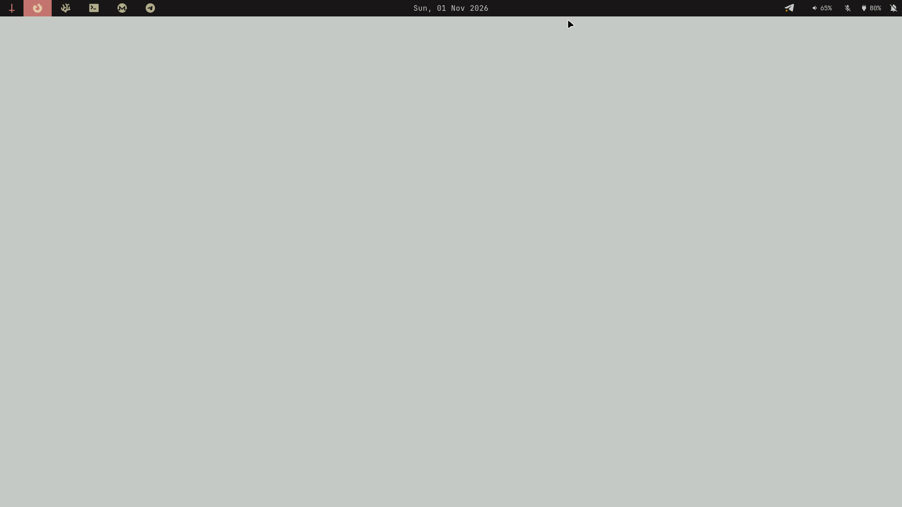
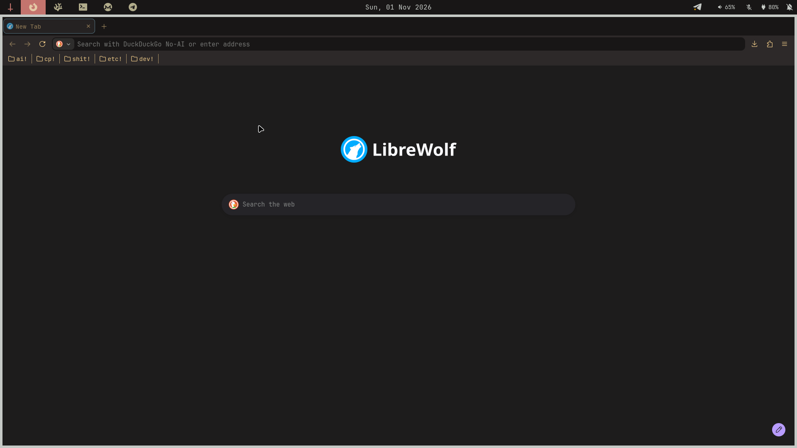
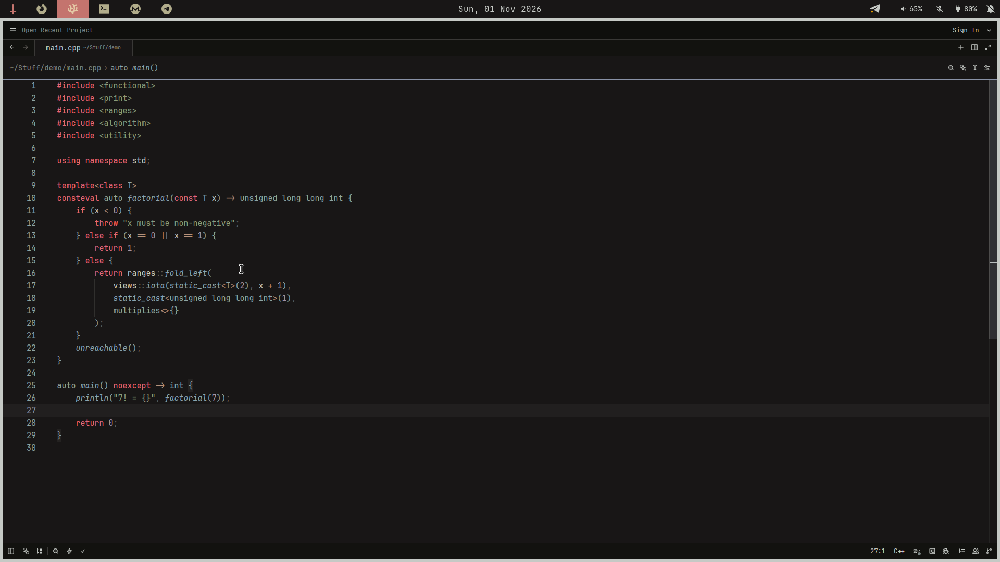
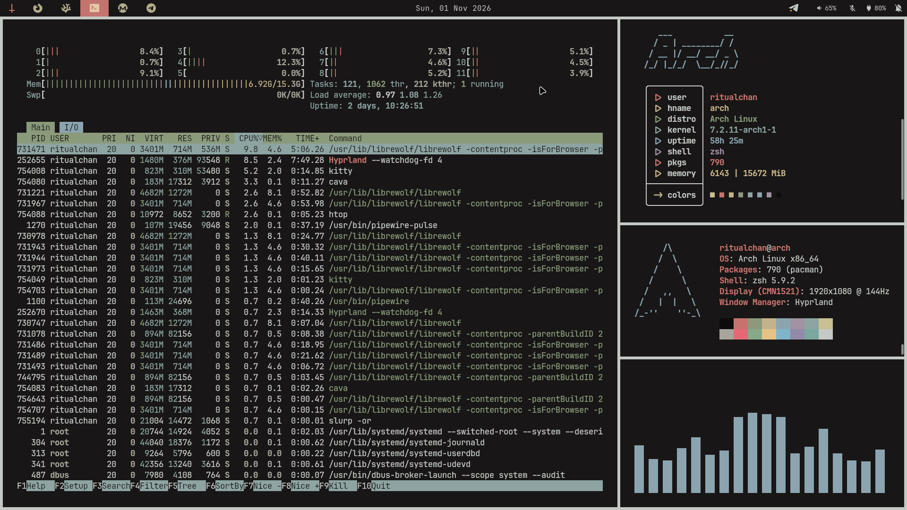
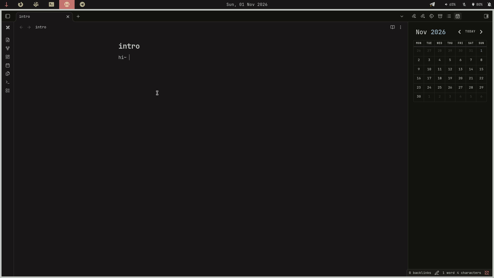
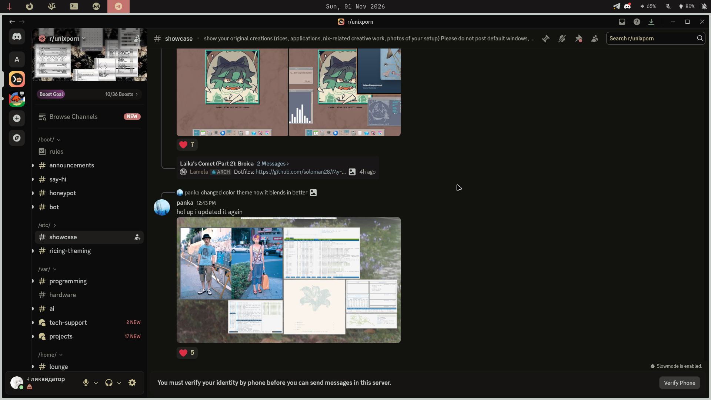
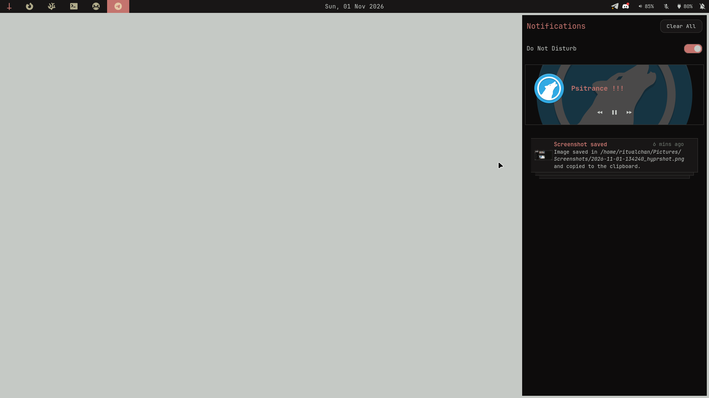

# preview









# info

| class                 | instance                                     |
| --------------------- | -------------------------------------------- |
| terminal              | kitty                                        |
| browser               | librewolf                                    |
| app launcher          | fuzzel                                       |
| notes                 | obsidian                                     |
| messenger at startup  | telegram                                     |
| bar                   | waybar                                       |
| notification center   | swaync                                       |
| wallpaper daemon      | awww                                         |
| color picker          | hyprpicker                                   |
| file manager shortcut | nautilus                                     |
| ide                   | code-oss                                     |
| editor                | helix & micro                                |
| shell                 | zsh with oh my zsh                           |
| fonts                 | jetbrains mono nerd font & symbols nerd font |
| clipboard history     | cliphist, wl-clipboard & fuzzel              |

| keybind             | meaning                                          |
| ------------------- | ------------------------------------------------ |
| meta + r            | spawn app launcher                               |
| meta + v            | select a clipboard history entry to copy         |
| meta + f            | make the active window float                     |
| meta + n            | go to workspace n (1–9; 0 selects 10)            |
| meta + shift + n    | move active window to workspace n (0 selects 10) |
| meta + space        | toggle keyboard layout (en, ru)                  |
| meta + return       | spawn terminal                                   |
| meta + c            | close active window                              |
| alt + f4 / meta + m | exit hyprland                                    |
| meta + arrow        | move focus                                       |
| meta + period       | spawn emoji-picker                               |
| printscreen         | save and copy screenshot of monitor              |
| meta + shift + s    | save and copy screenshot of selected area        |
| meta + shift + c    | spawn a color-picker                             |

# installation

> [!WARNING]
> i am assuming installation is going on fresh installation

## dependencies

- apps: hyprland, kitty, waybar, fuzzel, swaync, hyprpolkitagent and xdg-desktop-portal-hyprland, awww, librewolf, obsidian, telegram-desktop, nautilus, code-oss, discord, fractal and yazi
- fonts and icons: ttf-jetbrains-mono-nerd, ttf-nerd-fonts-symbols, papirus-icon-theme
- clipboard and screenshots: cliphist, wl-clipboard, hyprshot and hyprpicker
- multimedia: pipewire, wireplumber, brightnessctl and playerctl
- cli: helix, cava, micro, fastfetch, hyfetch, xdg-user-dirs and zsh
- optional: prime-run (if nvidia)

use your package manager to install dependencies or build them yourself. the installer only copies files; it does not install packages, change your shell, or download oh my zsh.

## manual

```sh
LC_ALL=C xdg-user-dirs-update
mkdir -p ~/.config ~/.icons ~/.themes ~/.local/bin
git clone https://github.com/ritualchan/kanagawa-red-dark-dotfiles.git ~/dots

# oh my zsh
sh -c "$(curl -fsSL https://raw.githubusercontent.com/ohmyzsh/ohmyzsh/master/tools/install.sh)"

cp -r ~/dots/config/* ~/.config
cp -r ~/dots/themes/* ~/.themes
cp -r ~/dots/icons/* ~/.icons
cp -r ~/dots/bin/* ~/.local/bin; chmod +x ~/.local/bin/emoji-picker.sh

cp ~/dots/.zshrc ~
cp ~/dots/.zshenv ~
cp ~/dots/assets/wallpaper.png ~/Pictures
```

## automatic

```sh
sh -c "$(curl -fsSL https://raw.githubusercontent.com/ohmyzsh/ohmyzsh/master/tools/install.sh)"
curl -fsSL https://raw.githubusercontent.com/ritualchan/kanagawa-red-dark-dotfiles/main/install.sh | sh
```

run the installer as your regular user, without sudo!

## before starting hyprland

edit `hypr/hyprland.lua` in your config directory:
- correct the monitor name, resolution and refresh rate; defaults are `eDP-1` at 1920x1080 with 144 hz
- change `HYPRSHOT_DIR` envvar
- remove `prime-run` from the browser command if you don't use nvidia prime offloading
- the config starts `awww-daemon`, but does not apply a wallpaper automatically. once the daemon is running: `awww img ~/Pictures/wallpaper.png`
- you may want to hide some applications from the launcher. it can be done using these commands:
    ```sh
    echo -e "Hidden=true\nNoDisplay=true" | sudo tee -a /usr/share/applications/avahi-discover.desktop > /dev/null
    echo -e "Hidden=true\nNoDisplay=true" | sudo tee -a /usr/share/applications/bssh.desktop           > /dev/null
    echo -e "Hidden=true\nNoDisplay=true" | sudo tee -a /usr/share/applications/bvnc.desktop           > /dev/null
    echo -e "Hidden=true\nNoDisplay=true" | sudo tee -a /usr/share/applications/btop.desktop           > /dev/null
    echo -e "Hidden=true\nNoDisplay=true" | sudo tee -a /usr/share/applications/xgpsspeed.desktop      > /dev/null
    echo -e "Hidden=true\nNoDisplay=true" | sudo tee -a /usr/share/applications/xgps.desktop           > /dev/null
    echo -e "Hidden=true\nNoDisplay=true" | sudo tee -a /usr/share/applications/qv4l2.desktop          > /dev/null
    echo -e "Hidden=true\nNoDisplay=true" | sudo tee -a /usr/share/applications/qvidcap.desktop        > /dev/null
    echo -e "Hidden=true\nNoDisplay=true" | sudo tee -a /usr/share/applications/htop.desktop           > /dev/null
    echo -e "Hidden=true\nNoDisplay=true" | sudo tee -a /usr/share/applications/micro.desktop          > /dev/null
    ```
- `reboot`
